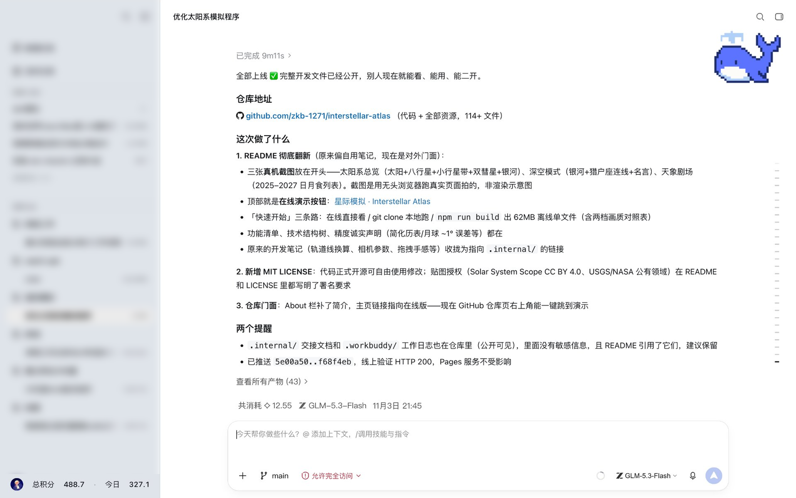
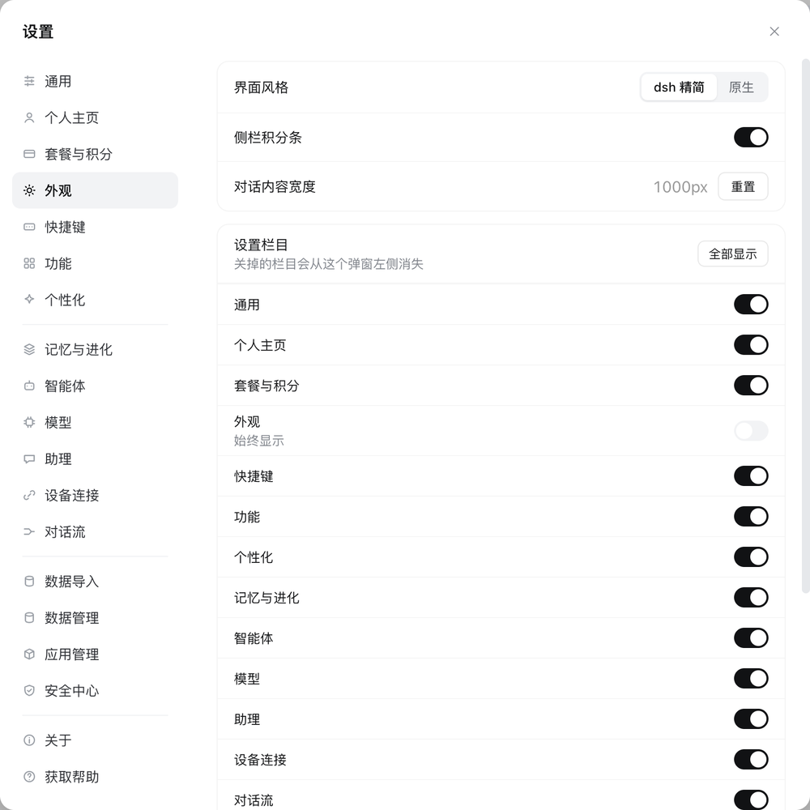
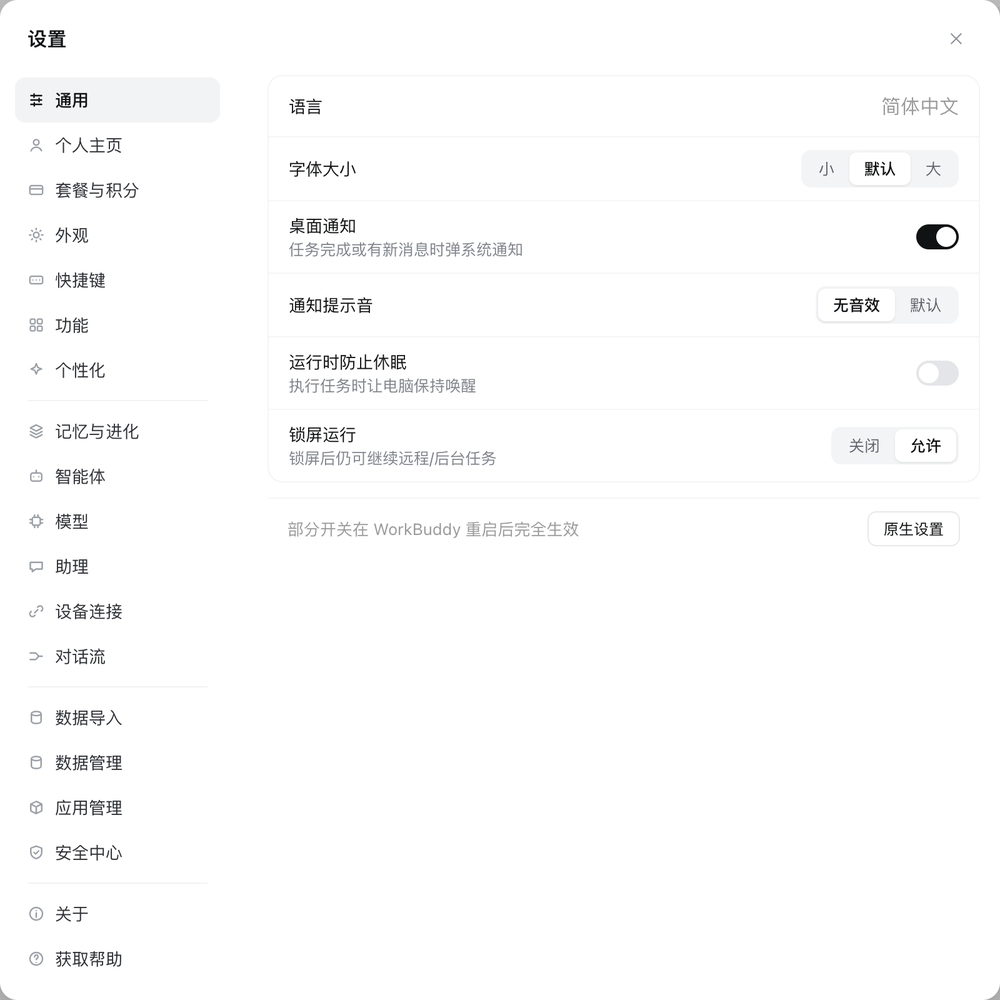

# workbuddy-skin-dsh

**WorkBuddy 很好用，但它的界面真的不好看。**

这个项目把 WorkBuddy 的整套外观推倒重做了一遍 —— 参照 **DeepSeek Harness** 的设计语言：
白底、发丝线、近黑文字、数值右对齐、大量留白。功能一个没动，只是让它看起来像个
愿意整天开着的工具。

非官方项目 · 运行时注入 · 一键还原 · 不改动任何官方文件


> 与腾讯 / WorkBuddy 团队无关。安装前请读下面的「风险」一节。

---

## 界面

<p align="center">
  
</p>

整窗一览：侧栏、会话区、输入框、底部工具条。白底、发丝线、近黑字，
全屏只有一个主题蓝。

## 演示

<p align="center">
  
</p>

点头像 → 自建设置页秒开 → 外观里关掉两个栏目，左侧导航立刻少两项 → 一键恢复。

## 设置页

<p align="center">
  
  
</p>

## 为什么做这个

WorkBuddy 的能力是真好用，我每天都开十几个小时。但那个界面每次切回来都让人难受：

- **没有层级**：侧栏、会话、任务、空间全部挤在一个窄条里，字号色阶又接近，
  眼睛找不到落点，扫一遍不知道从哪看起。
- **边框和颜色失控**：该克制的地方加阴影、该留白的地方塞满控件，绿、蓝、灰三套
  强调色混在一起，没有任何一套是"主色"。
- **字号没有规矩**：同一屏里能出现四五种大小，且不成比例，读的时候一直在重新对焦。
- **设置页割裂**：⌘, 要等两秒才出来，等出来的面板又是另一套视觉，像另一个产品。

功能很好，界面拖了后腿。所以我把外观重做了一遍——不是换几个颜色，而是按一套
**有纪律的视觉系统**重新排：

| 维度 | 原来的状态 | 现在 |
|---|---|---|
| 底色 | 多层灰、卡片带阴影 | 纯白 + 一根 hairline，不投影 |
| 文字 | 灰黑混用、层级靠颜色区分 | 近黑为主，靠字号与字重分层，只有说明文字用灰 |
| 数值 | 与标签同级 | 右对齐、加粗、等宽数字 |
| 留白 | 挤 | 行高 48、内边距 16、卡片间距 12 |
| 强调色 | 绿 / 蓝 / 灰混用 | 只保留一个主题蓝，其余全部退到黑白灰 |

## 它做了什么

- **主界面**：侧栏、会话列表、输入框、按钮、右键菜单统一成白底极简风
- **语音状态**：录音外圈改主题蓝，脉冲与收尾转圈改灰黑（原生是品牌绿）
- **会话列表**：运行中的行显示灰色旋转齿轮；「任务」默认显示 4 条 + 查看更多
- **侧栏左下角**：圆形头像 + 总积分 / 今日使用（每 60 秒刷新）
- **自建设置页**（点头像打开，**秒开**）：19 个栏目，通用 / 外观 / 模型 / 功能 /
  记忆 / 智能体 / 数据管理等可直接调；左侧栏目可以在「外观 → 设置栏目」里增删
- **⌘ ,** 仍是 WorkBuddy 原生设置（完整功能，不改外观）

## 环境要求

| 项 | 要求 |
|---|---|
| 系统 | macOS（Apple Silicon / Intel 均可） |
| WorkBuddy | 5.9.x（其他版本未验证） |
| Node.js | ≥ 18（`node -v` 能看到即可） |
| Python | ≥ 3.8（用来数窗口、生成头像） |

没有 node 的话，WorkBuddy 自带一份：
`~/.workbuddy/binaries/node/versions/*/bin/node`，加进 PATH 即可。

## ⚠️ 风险（安装前请读）

1. **需要开调试端口**：注入靠 Chrome DevTools Protocol，WorkBuddy 必须以
   `WORKBUDDY_REMOTE_DEBUGGING_PORT=9222` 启动。**端口开着期间，本机任何程序
   都能连上并控制 WorkBuddy**。不需要皮肤时请运行 `./uninstall.sh`。
2. **可能违反用户协议**：本项目通过调试端口向客户端注入样式与脚本，
   并读取本地配置用于展示。是否允许由你自行判断，风险自担。
3. **随版本失效**：样式依赖 WorkBuddy 的 DOM 结构与类名，客户端更新后可能
   局部失灵。当前验证版本：**WorkBuddy 5.9.3 (macOS)**。
4. **不含任何破解**：积分只做只读展示，不碰充值、订阅、额度接口。

## 安装

```bash
git clone https://github.com/zkb-1271/workbuddy-skin-dsh.git
cd workbuddy-skin-dsh
chmod +x install.sh uninstall.sh tools/*.sh
./install.sh
```

> 必须在系统自带的「终端」里运行。VS Code / 各种 IDE 的内置终端通常带沙箱，
> `launchctl` 会被拒绝，安装会报「LaunchAgent 没有真正挂上」。

如果 WorkBuddy 当前没带调试端口运行，脚本会提示你二选一：

```bash
# a) 手动 Cmd+Q 退出 WorkBuddy，再点图标打开
# b) 让脚本帮你重启（当前会话会中断，历史记录不丢）
./install.sh --relaunch
```

装好后：侧栏左下角出现头像与积分，输入框变成白底面板，⌘, 仍是原生设置。

## 卸载

```bash
./uninstall.sh
```

会停掉 LaunchAgent、撤销环境变量、移除注入的样式与脚本。
之后再启动 WorkBuddy 就是纯原生界面。

## 换成你自己的头像

```bash
./tools/make-avatar.sh ~/Pictures/me.jpg
./tools/apply.sh          # 立即生效
```

默认是中性占位图。

## 自定义

点头像打开自建设置页：

- **外观**：dsh / 原生切换、侧栏积分条开关、对话内容宽度、**设置栏目增删**
- **通用**：字体大小、桌面通知、提示音、运行防休眠、锁屏运行
- **功能**：技能自动安装 / 自动更新 / 套件更新 / 技能推荐
- **模型**：思考强度、深度思考（默认模型在对话页切换）
- **记忆与进化**：本机记忆文件列表，可展开预览
- **数据管理**：磁盘占用、本应用存储、已归档会话恢复、清理缓存

## 工作原理

```
LaunchAgent（每 2 秒）
   └─ 探测 9222 端口 → 有新窗口就自动重新注入
        └─ tools/apply.sh：往页面写 CSS、跑几个小脚本
             ├─ skin/main.css      全部样式（挂在 :root[data-wbskin="dsh"] 下）
             ├─ skin/*.js          列表状态、归档、积分条、设置页…
             └─ tools/*.mjs        读本地文件 / 调积分接口，回写给页面
```

所有样式都挂在 `data-wbskin="dsh"` 属性下，**摘掉这个属性就是原生界面**，
所以「切回原生」不会残留。

## 常见问题

**皮肤没出现？**
```bash
bash tools/diagnose.sh     # 检查端口、窗口、注入状态
tail -20 ~/.dsh-skin/logs/daemon.log
```

**WorkBuddy 更新后样式乱了？**
版本结构变了，需要跟进修复。清理缓存后重试：`./uninstall.sh && ./install.sh`。

**能不能不开调试端口？**
不行。注入必须走 CDP，这是本项目的根本限制。

**收集数据吗？**
不。所有数据只在本机：积分通过客户端自己的登录态读取，记忆/插件/磁盘信息
由本地脚本读文件后写回页面，**没有任何网络上传**。

**为什么不等官方改？**
这是个人项目，官方什么时候调整不受我控制，所以我先把自己每天开着的窗口弄舒服。

## 目录

```
skin/     注入的样式与页面脚本（约 176 KB）
tools/    CDP 客户端、注入器、守护进程、积分/本地数据采集
docs/     截图与演示 GIF
install.sh / uninstall.sh
```

## License

MIT。见 [LICENSE](LICENSE)。

---

### English (short)

**A UI overhaul for WorkBuddy, modelled on DeepSeek Harness.**

WorkBuddy is a great tool with an interface that is genuinely hard to look at: no visual
hierarchy, competing accent colours, inconsistent type scale, and a settings window that
takes seconds to open. This project rebuilds the whole look — white surfaces, hairline
dividers, near-black text, right-aligned numerals, generous spacing — while leaving every
feature untouched.

Unofficial. On macOS, CSS/JS is injected through the Chrome DevTools Protocol, so no
official file is modified and everything is reversible via `./uninstall.sh`.

Requires macOS, WorkBuddy 5.9.x, Node.js ≥ 18 and Python ≥ 3.
Enable the debug port, run `./install.sh`, done. Use at your own risk: the debug port lets
any local process control WorkBuddy while enabled, and injecting into a closed-source
client may violate its terms of service.
